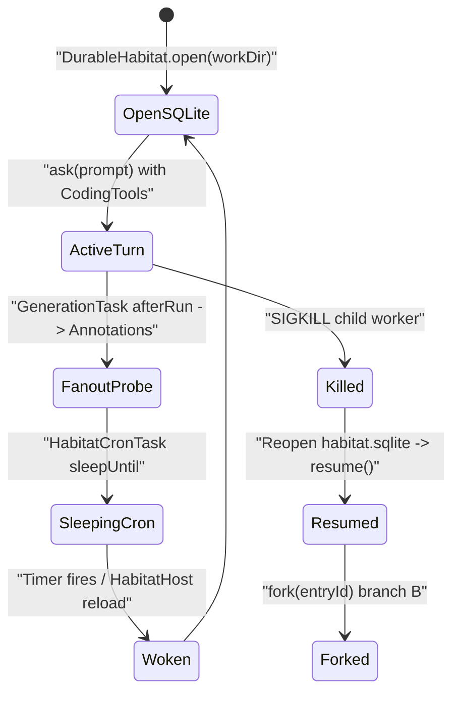

# Lab 01 — Pi Durable Agent Lifecycle Torture Box

- **Goal:** Build a self-contained CLI/TUI sandbox that lets you interactively crash, resume, fork, cron-wake, annotate, and guard-test a real `@earendil-works/pi-durable` `DurableHabitat`.
- **Modes:** Offline mock (`fauxProvider`, default) and real models (`--live --model <provider:model>`).
- **Repo Anchors:** [`packages/habitat/src/durable/durable-habitat.ts`](../../packages/habitat/src/durable/durable-habitat.ts), [`packages/habitat/src/durable/extensions.ts`](../../packages/habitat/src/durable/extensions.ts), [`docs/specs/orchestration/durable-habitats.md`](../../docs/specs/orchestration/durable-habitats.md), [`examples/durable-habitat/host.ts`](../durable-habitat/host.ts).

---

## 1. What You're Testing

- **Crash safety (`SIGKILL`):** If a worker dies mid-generation or mid-tool-call, what does `harness.resume()` on the reopened `habitat.sqlite` preserve cleanly, and what needs application-level idempotency?
- **Zero-copy forks:** When comparing two prompts or debugging a wrong turn from mid-conversation, does `fork(entryId)` isolate child history without mutating the parent timeline?
- **Autonomous wakes & fan-out probes:** How do durable `HabitatCronTask` sleep/wake timers (`wake().active`) interact with `HabitatHost` idle eviction (`idleEvictMs`), and how clean are post-turn `ConversationAnnotationsDoc` sidecars?
- **Repo write boundaries:** Does `createRepoScopeExtension` reliably allow reads on **Mounted** repos while blocking `write`/`edit` outside the **Owned** repo and `workDir`?

---

## 2. Visual Target (Architecture & Mockup)



Target terminal inspector layout (what you want to see after sending prompts and hitting edge cases):

```text
╔══════════════════════════════════════════════════════════════════════╗
║ PI DURABLE TORTURE BOX · sqlite: /tmp/umwelten-lab01/habitat.sqlite  ║
╠══════════════════════════════════════════════════════════════════════╣
║ Owned Repo (R/W):   ./owned-app/                                     ║
║ Mounted Repo (R/O): ./mounted-lib/                                   ║
║ Conversations:                                                       ║
║   [root]   turns=4  entries=11  wake=armed(next: +12s) [ACTIVE]      ║
║   [fork-1] turns=2  entries=6   branchedFrom=entry_04                ║
╠──────────────────────────────────────────────────────────────────────╣
║ Annotations (ConversationAnnotationsDoc):                            ║
║   #1 turn=entry_03 probe=word-count -> "42 words"                    ║
║   #2 turn=entry_06 probe=risk-flag  -> "touched config.ts"           ║
║ Repo Guard Log:                                                      ║
║   READ  ./mounted-lib/constants.ts      -> ALLOWED                   ║
║   WRITE ./mounted-lib/constants.ts      -> BLOCKED (Mounted R/O)     ║
║   WRITE ./owned-app/NOTES.md            -> ALLOWED                   ║
╚══════════════════════════════════════════════════════════════════════╝
Commands: /ask <msg> | /fork <entryId> | /tree | /crash | /cron | /guard | /quit
```

---

## 3. Spin-Up & Prerequisites

Create or switch to a throwaway prototype branch and confirm `packages/habitat` already passes tests cleanly:

```zsh
git checkout -b prototype/lab-01-pi-durable
pnpm exec vitest run packages/habitat/src/durable/durable-habitat.test.ts
```

Verify the existing minimal example runs cleanly on this machine:

```zsh
pnpm exec tsx examples/durable-habitat/host.ts
```

---

## 4. Coding-Agent Prompt (Copy-Paste)

> Copy everything inside the block below and paste it into Pi, Antigravity, Claude Code, or Codex in this repo.

```text
Build a self-contained lab prototype under `examples/lab-01-pi-durable/` that exercises `@umwelten/habitat` (`DurableHabitat` and `HabitatHost` on `@earendil-works/pi-durable`) as an interactive lifecycle torture box.

Read these repo files first to match exact types and invariants:
- `docs/specs/orchestration/durable-habitats.md`
- `packages/habitat/src/durable/durable-habitat.ts`
- `packages/habitat/src/durable/extensions.ts`
- `packages/habitat/src/durable/durable-habitat.test.ts`

Requirements:
1. Create `examples/lab-01-pi-durable/run.ts` (plus a short `README.md`) runnable via `pnpm exec tsx examples/lab-01-pi-durable/run.ts` (default offline `fauxProvider` mode, plus `--live --model <provider:model>` support via `@umwelten/pi`'s `resolvePiModel`/`parseModelSpecString`).
2. Inside a temporary `mkdtemp` root, initialize:
   - An **Owned** git directory (`owned-app/`) and a **Mounted** read-only library directory (`mounted-lib/`).
   - A SQLite-backed `DurableHabitat` (`workDir` + `env: "local"` + `ownedRepoRoot` + `mountedReadOnlyRoots`) with two `TurnAnnotationProbe`s (e.g. `summary-tag` and `tool-audit`) stored in `ConversationAnnotationsDoc`.
3. Provide an interactive REPL AND an automated `--smoke` flag (which runs all checks non-interactively and exits 0):
   - `/ask <prompt>` — sends a turn and prints assistant text + entry IDs + newly recorded annotations.
   - `/tree` — displays current root & forked conversations, entry IDs, `ConversationAnnotationsDoc`, and wake status.
   - `/fork <entryId> <prompt>` — forks the conversation from `<entryId>`, runs a divergent turn on the fork, and proves parent entry count did not change.
   - `/guard` — triggers two tool turns: reading from `mounted-lib/` (must succeed) and attempting to `write` into `mounted-lib/` (must be blocked by `createRepoScopeExtension`).
   - `/crash` — spawns a child Node worker holding `habitat.sqlite` mid-turn, sends `SIGKILL` to the worker, waits briefly, reopens the same `habitat.sqlite` cleanly in the parent (or fresh worker), calls resume/inspect, and prints recovered entries vs. pre-crash state.
   - `/cron` — registers/runs a short durable schedule (or triggers cron tick) and verifies wake behavior + `HabitatHost` idle eviction (`idleEvictMs`) + transparent reload on next request.
4. Ensure zero `any` types, strict TypeScript clean (`tsc --noEmit`), proper cleanup in `finally`, and test everything by running `--smoke`.
```

---

## 5. Interactive Walkthrough (Kick the Tires)

Once the agent finishes building `examples/lab-01-pi-durable/`, start the interactive REPL and work through these 5 drills:

1. **Observe persistent SQLite writes:**
   - Run `/ask Create owned-app/hello.txt after reading mounted-lib/version.txt`
   - Run `/tree` and note the entry IDs and `ConversationAnnotationsDoc` items.
2. **Test zero-copy branch divergence:**
   - Run `/fork <early-entry-id> Try an alternate plan and write owned-app/plan-b.txt`
   - Run `/tree` again and verify the original conversation stayed untouched while the branch diverges cleanly.
3. **Verify Mounted R/O boundary:**
   - Run `/guard` (or ask the model in `--live` mode to modify `mounted-lib/version.txt`) and confirm the tool call is blocked with `"outside"` / read-only enforcement.
4. **Torture crash recovery (`SIGKILL`):**
   - Run `/crash` and watch the worker die abruptly, release SQLite locks cleanly at OS process exit, reopen the same file, and inspect what survived.
5. **Test live model reasoning (`--live`):**
   - Run with `--live --model ollama:qwen4:32b` or `--live --model google:gemini-4-hydrogen` and try multi-step coding + reflection inside the Owned repo.

---

## 6. Did the Prompt Work? (Verification & Tuning)

Run both offline smoke verification and strict TypeScript check:

```zsh
pnpm exec tsx examples/lab-01-pi-durable/run.ts --smoke
pnpm exec tsc --noEmit --target ES2022 --module NodeNext --moduleResolution NodeNext --esModuleInterop --strict --skipLibCheck examples/lab-01-pi-durable/run.ts
```

Pass criteria:
- `--smoke` exits `0` without hanging handles, printing PASS for `ask`, `fork`, `guard` (read allowed, mounted write blocked), `crash` (`SIGKILL` + reopen), and `cron`/eviction reload.
- In `--live` mode or REPL, `mounted-lib/` checksums remain identical before and after `/guard`.

Tuning hints if the agent struggles:
- **Fork or resume SQLite lock errors (`SQLITE_BUSY`):** Remind the agent of the single-writer invariant in `docs/specs/orchestration/durable-habitats.md`: close the parent `DurableHabitat` (`await habitat.close()`) *before* spawning a child worker on the same `habitat.sqlite` path, and wait for the killed child's `exit` event *before* reopening in the parent.
- **Mock tool rounds stop after 1 turn:** Remind the agent that `fauxAssistantMessage(blocks)` defaults `stopReason` to `"stop"`; pass `{ stopReason: "toolUse" }` on tool-call turns.
