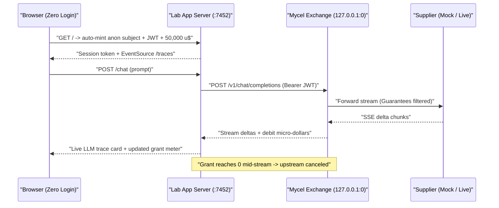

# Lab 02 — Authless Dynamic-Grant Mycel + Live LLM Trace Stream

- **Goal:** Prototype a zero-login application client backed by `@umwelten/mycel` that mints ephemeral End User subjects with starter micro-dollar grants from the Client balance, streams every live LLM request/response/charge as traces, and dynamically adjusts or cuts off grants mid-stream.
- **Modes:** Offline mock (`startMockUpstream`, default) and real models (`--live` wired to an OpenAI-compatible supplier).
- **Repo Anchors:** [`packages/mycel/src/auth/identity.ts`](../../packages/mycel/src/auth/identity.ts), [`packages/mycel/src/dispatch.ts`](../../packages/mycel/src/dispatch.ts), [`packages/mycel/src/server.ts`](../../packages/mycel/src/server.ts), [`docs/specs/exchange/mycel-and-suppliers.md`](../../docs/specs/exchange/mycel-and-suppliers.md), [`examples/mycel-e2e/run.ts`](../mycel-e2e/run.ts).

---

## 1. What You're Testing

- **Authentication-less UX vs. real accountability (ADR 0014):** If a browser user never creates an account and gets a short-lived ES256 JWT + starter micro-dollar grant silently on connect, how smoothly do ephemeral subjects isolate balances while keeping the owning Client protected?
- **Trace-driven dynamic grants:** Can streaming LLM traces (prompt content, token velocity, supplier cost vs. retail charge) drive automatic policy decisions (auto-renew starter grant vs. rate-throttle vs. deny top-up) *outside* the Exchange itself?
- **Boundary enforcement:** When an End User hits zero balance *during a streamed generation*, does Mycel cancel the upstream Supplier cleanly and debit exact integer micro-dollars?

---

## 2. Visual Target (Architecture & Mockup)



Target browser workbench UI (Bell Labs Warm Paper style on `127.0.0.1:7452`):

```text
┌────────────────────────────────────────────────────────────────────────────┐
│ MYCEL LAB · Authless Dynamic Grants & Live LLM Traces     [anon-8f3c]      │
├─────────────────────────────────┬──────────────────────────────────────────┤
│ EPHEMERAL GRANT & CHAT          │ LIVE TRACE WATERFALL (SSE)               │
│ Subject: anon-8f3c (no login)   │                                          │
│ Grant:   [████░░░░░░] 18,420 u$ │ 12:04:01.102 POST /v1/chat/completions   │
│ Ceiling: 50,000 u$ ($0.0500)    │   app=demo-app  subject=anon-8f3c        │
│ Client Reserve: 950,000 u$      │   guarantee=[on-premise] cap=[streaming] │
│ Policy: [Auto-TopUp if OK v]    │   supplier=office-spark model=gemma-4-26b│
│                                 │   tokens: 412 prompt -> 185 completion   │
│ Prompt: _______________________ │   charge: 1,580 u$ | ttft: 42ms          │
│ [Send Turn] [Drain to Low u$]   │                                          │
│ [Mint Fresh Anon Session]       │ 12:04:05.330 STREAM CUTOFF (balance <= 0)│
│                                 │   upstream aborted cleanly at tok #94    │
└─────────────────────────────────┴──────────────────────────────────────────┘
```

---

## 3. Spin-Up & Prerequisites

Verify the existing Mycel end-to-end script and Exchange test suite pass before editing:

```zsh
pnpm exec tsx examples/mycel-e2e/run.ts
pnpm exec vitest run packages/mycel/src/dispatch.test.ts packages/mycel/src/auth/identity.test.ts
```

---

## 4. Coding-Agent Prompt (Copy-Paste)

```text
Build a self-contained prototype under `examples/lab-02-mycel-traces/` exploring an authentication-less client UX on `@umwelten/mycel` with ephemeral JWT grants funded from the Client balance and a live SSE LLM trace waterfall UI.

Read these files first so every API call, invariant, and unit matches the repo:
- `docs/specs/exchange/mycel-and-suppliers.md`
- `examples/mycel-e2e/run.ts`
- `packages/mycel/src/auth/identity.ts`
- `packages/mycel/src/server.ts`
- `packages/mycel/src/dispatch.ts`

Requirements:
1. Create `examples/lab-02-mycel-traces/server.ts` (plus `README.md`) listening strictly on `127.0.0.1` (`--port 7452` default, `0` allowed in smoke tests), defaulting to `startMockUpstream` (multiple mock/stream responses) and supporting `--live` when pointed at an upstream OpenAI-compatible endpoint.
2. On startup, boot an in-process `MemoryStore` + `createExchangeServer` configured with `createIdentityVerifier` using a locally generated ES256 keypair (`jose`), a Client (`"lab-client"`, funded with e.g. `5_000_000` integer micro-dollars), an Application (`"authless-web"`), and registered Supplier offer(s) enforcing at least one `Guarantee` (e.g. `on-premise`).
3. Keep all monetary accounting strictly in integer micro-dollars (`$1.00 = 1_000_000`) per `integer-micro-dollar-boundary-metering`:
   - `POST /api/session` creates a brand-new anonymous `subject` (`anon-<hex>`), grants it a configurable starter micro-dollar budget debited cleanly from the Client reserve (`Balances`), and returns a short-lived signed ES256 JWT (no login/password).
   - `POST /api/chat` runs a streaming completion through `@umwelten/pi`'s `runPiTurn` or OpenAI `/v1/chat/completions` against the local Exchange as that anonymous JWT, emitting live trace events over `GET /api/traces` (SSE): timestamps, subject, matched supplier, guarantees checked, streaming token chunks, prompt/completion counts, retail micro-dollar charge, remaining grant, and whether stream cutoff triggered.
   - `POST /api/grant-policy` lets the user toggle dynamic trace-based grant rules (e.g. "auto top-up +20,000 u$ if latency < 2s and client reserve > 50%", or "strict cap at 0 — test mid-stream cutoff").
   - `POST /api/drain` sets the current anonymous subject's remaining grant to a tiny amount (e.g. `500` micro-dollars) so you can deterministically trigger and observe mid-stream upstream cancellation on the very next turn.
4. Serve a single-file Bell Labs Warm Paper HTML page at `GET /` (reusing CSS tokens from `scripts/site-styles.ts` or inline) showing the Grant Gauge, Prompt Chat, Dynamic Policy Selector, and live SSE Trace Waterfall. Include `new Function` clean JS validation and a `--smoke` flag exercising session mint → streamed turn → trace receipt → mid-stream balance exhaustion cutoff → clean shutdown.
```

---

## 5. Interactive Walkthrough (Kick the Tires)

1. **Zero-login minting:** Open `http://127.0.0.1:7452`, notice you are immediately assigned `anon-...` with a funded starter grant — send two turns and watch micro-dollars decrement in real time.
2. **Switch identity instantly:** Click **Mint Fresh Anon Session** and confirm the new subject starts with an isolated ledger balance while the Client Reserve reflects both allocations.
3. **Trigger mid-stream balance cutoff:** Click **Drain to Low u$**, send a long prompt, and watch the Exchange abort upstream streaming cleanly at zero without going deeply negative.
4. **Test trace-gated renewal:** Enable **Auto-TopUp** policy, send requests, and watch the dynamic trace evaluator decide whether to fund another slice or throttle based on token spend per turn.

---

## 6. Did the Prompt Work? (Verification & Tuning)

Run smoke test, typecheck, and confirm Mycel's core invariants still hold:

```zsh
pnpm exec tsx examples/lab-02-mycel-traces/server.ts --smoke
pnpm exec tsc --noEmit --target ES2022 --module NodeNext --moduleResolution NodeNext --esModuleInterop --strict --skipLibCheck examples/lab-02-mycel-traces/server.ts
```

Pass criteria:
- `--smoke` verifies HTTP `200` on `GET /`, anonymous JWT session creation, SSE trace delivery with non-zero integer `charge` micro-dollars, and mid-stream cutoff/error handling when balance hits zero.
- Every balance mutation uses integers (no floats like `0.0012` passed into `Balances`).

Tuning hints if the agent struggles:
- **Mycel rejects requests with `401` / `unknown_application`:** Check that the JWT's `iss` matches the `Application.id` registered in `store.createApplication(...)` (`setIssuer("authless-web")`), matching lines 95–101 of `examples/mycel-e2e/run.ts`.
- **`@umwelten/pi` imports `@umwelten/mycel`:** Ensure the web server calls HTTP `/v1/chat/completions` cleanly so `@umwelten/pi` never imports `@umwelten/mycel` directly (`acyclic-exchange-boundary`).
