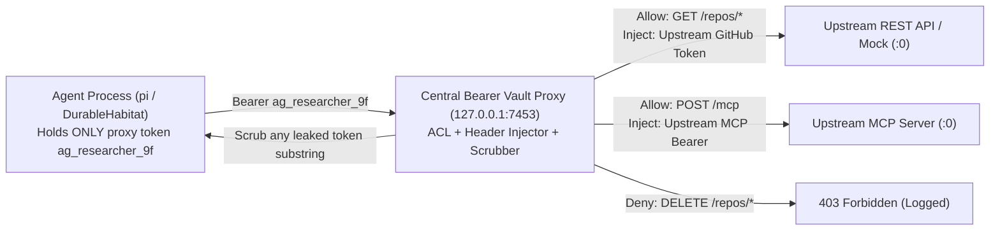

# Lab 03 — Centralized Bearer-Token Vault & HTTP/MCP Credential Proxy

- **Goal:** Build a centralized loopback credential-injecting proxy for external REST APIs and MCP servers so `DurableHabitat` or `pi` agents hold **zero upstream API keys or bearer tokens** — only a scoped proxy token identifying the caller.
- **Modes:** Offline mock upstreams (default, no external keys required) and real upstream APIs via `.env` / Vault lookup (`--live`).
- **Repo Anchors:** [`packages/protocols/src/mcp-serve/server.ts`](../../packages/protocols/src/mcp-serve/server.ts), [`packages/protocols/src/mcp/client/remote.ts`](../../packages/protocols/src/mcp/client/remote.ts), [`packages/habitat/src/durable/durable-habitat.ts`](../../packages/habitat/src/durable/durable-habitat.ts).

---

## 1. What You're Testing

- **Secret isolation:** If an agent is prompt-injected (`print process.env`, `curl -v`, or inspect headers), can we guarantee upstream bearer/OAuth tokens *never* enter the agent process or return in proxied error bodies?
- **Per-agent route & method ACLs:** How ergonomic is a small declarative route manifest granting Agent A `GET` on `/repos/*` while rejecting `POST`/`DELETE` with `403` before reaching upstream?
- **SSE & MCP compatibility:** Does a thin Node reverse proxy cleanly stream Chunked / SSE / Streamable HTTP MCP traffic without buffering hangs or header corruption?

---

## 2. Visual Target (Architecture & Mockup)



Target terminal console / web audit view:

```text
══════════════════════════════════════════════════════════════════════════════
 BEARER VAULT PROXY · http://127.0.0.1:7453 (upstream tokens NEVER leave vault)
══════════════════════════════════════════════════════════════════════════════
 Configured Principals:
   agent-reader -> routes: [mock-github (GET), docs-mcp (POST,GET)]
   agent-writer -> routes: [mock-github (GET,POST), docs-mcp (POST,GET)]

 Live Audit Stream:
   14:10:02  agent-reader  GET  /proxy/mock-github/repos/umwelten/issues -> 200 (12ms)
             injected: github-ro-token (sha256:9b12..) | scrubbed: 0 secret match(es)
   14:10:04  agent-reader  POST /proxy/mock-github/repos/umwelten/issues -> 403 DENIED
             rule violation: method POST not in [GET]
   14:10:07  agent-reader  GET  /proxy/mock-github/echo-auth-header      -> 200 [REDACTED]
             ALERT: upstream echoed credential bytes -> replaced with [REDACTED_VAULT_SECRET]
```

---

## 3. Spin-Up & Prerequisites

Switch to a prototype branch (no external accounts required in default mock mode):

```zsh
git checkout -b prototype/lab-03-bearer-proxy
pnpm exec vitest run packages/protocols/src/discovery/discover.test.ts
```

---

## 4. Coding-Agent Prompt (Copy-Paste)

```text
Build a self-contained lab prototype under `examples/lab-03-bearer-proxy/` implementing a centralized Bearer-Token Vault HTTP & MCP Proxy bound strictly to `127.0.0.1`, paired with an agent harness proving the agent never holds or sees upstream secrets.

Read these files first for context and protocol conventions:
- `packages/protocols/src/mcp-serve/server.ts`
- `packages/protocols/src/mcp/client/remote.ts`
- `packages/habitat/src/durable/durable-habitat.ts`

Requirements:
1. Create `examples/lab-03-bearer-proxy/proxy.ts` (vault + proxy server) and `examples/lab-03-bearer-proxy/run.ts` (demo + `--smoke` verifier) plus `README.md`.
2. Design a clean Vault + Route Manifest:
   - Secrets map: logical secret IDs (`"upstream-api-secret"`, `"upstream-mcp-secret"`) resolved from memory or `process.env`.
   - Upstreams map: route prefix (`/proxy/api`, `/proxy/mcp`) -> baseUrl + secret ID.
   - Agent Principals map: short-lived/scoped agent bearer tokens (`token` verified via constant-time `timingSafeEqual`) -> allowed route prefixes + allowed HTTP methods (`GET`, `POST`, etc.) + optional path globs.
3. Proxy enforcement:
   - Never forward the agent's proxy `Authorization` header to upstream; strip it and inject the upstream's secret `Authorization: Bearer <secret>`.
   - Reject unauthenticated callers (`401`), disallowed routes/methods (`403`), and path traversal (`..` normalization before matching).
   - Stream response bodies cleanly (including `text/event-stream` / MCP Streamable HTTP headers) while running a streaming/chunked redactor that replaces any known upstream secret value (raw or base64) with `[REDACTED_VAULT_SECRET]` if an upstream debug endpoint tries to echo headers back!
   - Emit structured JSON audit records (`timestamp`, `agentId`, `method`, `upstream`, `status`, `latencyMs`, `redactions`).
4. Demonstrate BOTH:
   - An HTTP REST client / `DurableHabitat` tool calling `http://127.0.0.1:<port>/proxy/api/...` with zero upstream secrets in its environment (including an adversarial "echo headers" endpoint proving redaction works, and a forbidden `DELETE` request returning `403`).
   - An MCP client (`StreamableHTTPClientTransport` / `Client` from `@modelcontextprotocol/client` 2.x) connecting to a mock protected `createMcpServer` (`MemoryStore`) *through* `/proxy/mcp` with only the agent proxy token!
5. Support `--smoke` (starts proxy + mock REST upstream + mock MCP upstream on ephemeral ports, runs all positive + adversarial assertions, prints PASS table, closes everything cleanly) and `--port 7453` interactive audit mode.
```

---

## 5. Interactive Walkthrough (Kick the Tires)

1. **Test legitimate read path:** Point `curl` or `pi` (`bash` / custom tool) at `http://127.0.0.1:7453/proxy/api/items` with the `agent-reader` token — verify `200` and see `injected` in the proxy log.
2. **Test verb ACL enforcement:** Try `POST` or `DELETE` with `agent-reader` token — confirm immediate `403` before upstream is ever touched.
3. **Attempt exfiltration:** Hit a debug endpoint upstream that returns `{ receivedAuth: req.headers.authorization }` — verify the proxy rewrites the leaked string to `[REDACTED_VAULT_SECRET]` and flags `ALERT` in the audit log.
4. **Rotate secret without restarting the agent:** Reload the manifest/secret inside the proxy process and confirm the agent keeps working seamlessly with the exact same proxy token.

---

## 6. Did the Prompt Work? (Verification & Tuning)

```zsh
pnpm exec tsx examples/lab-03-bearer-proxy/run.ts --smoke
pnpm exec tsc --noEmit --target ES2022 --module NodeNext --moduleResolution NodeNext --esModuleInterop --strict --skipLibCheck examples/lab-03-bearer-proxy/proxy.ts examples/lab-03-bearer-proxy/run.ts
```

Pass criteria:
- `--smoke` proves: `401` without proxy token, `200` on allowed REST `GET`, `403` on forbidden `DELETE`, `[REDACTED_VAULT_SECRET]` masking on header-echo response, and working MCP `listTools` + `callTool` through `/proxy/mcp`.
- Searching process output and agent tool responses finds **zero occurrences** of any upstream secret string.

Tuning hints if the agent struggles:
- **Redaction misses chunk-boundary splits on SSE:** Tell the agent to maintain a small `tail` buffer (`maxSecretLength - 1` bytes) across chunks before flushing, or normalize headers/text cleanly before emitting.
- **MCP `Mcp-Session-Id` header dropped:** Make sure the proxy forwards `mcp-session-id` and `accept` headers in both directions for Streamable HTTP MCP servers.
