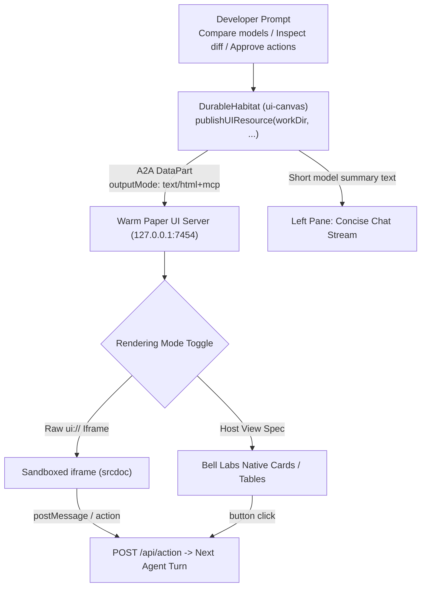

# Lab 04 — Adaptive Dev Result UI & `ui://` Resource Canvas

- **Goal:** Experiment side-by-side with what an agent should render back to a developer depending on what was asked ("compare runs", "inspect diff", "approve destructive step", "summarize metrics") — comparing raw `ui://` sandboxed HTML (`buildHabitatUIResource`) vs. declarative JSON views in a Bell Labs Warm Paper local workbench.
- **Modes:** Offline mock (`fauxProvider`, default) and live model UI synthesis (`--live --model <provider:model>`).
- **Repo Anchors:** [`packages/habitat/src/ui-resources.ts`](../../packages/habitat/src/ui-resources.ts), [`scripts/bench-ui-server.ts`](../../scripts/bench-ui-server.ts), [`scripts/site-styles.ts`](../../scripts/site-styles.ts), [`docs/specs/foundation/substrate-composition.md`](../../docs/specs/foundation/substrate-composition.md).

---

## 1. What You're Testing

- **Right abstraction level:** Does an agent produce cleaner, less fragile UIs by emitting freeform HTML via `buildHabitatUIResource({ uri: "ui://...", html })`, or by picking among 3–4 tight host-rendered view schemas (`comparison-table`, `diff-inspector`, `approval-gate`, `metric-strip`)?
- **Model vs. Human split:** Does keeping concise plain text for the conversation transcript while sending full `ui://` HTML / interactive specs to the browser canvas dramatically cut token clutter on follow-up turns?
- **Closed-loop UI actions:** When a developer clicks **Approve Selected** or toggles a filter inside the rendered card, how cleanly should that event post back as the next `DurableHabitat` input?

---

## 2. Visual Target (Architecture & Mockup)



Target browser canvas UI (`127.0.0.1:7454`):

```text
┌────────────────────────────────────────────────────────────────────────────┐
│ ADAPTIVE DEV UI CANVAS · http://127.0.0.1:7454     [Mode: Compare / ui://] │
├──────────────────────────────┬─────────────────────────────────────────────┤
│ CONVERSATION + ARCHETYPES    │ ADAPTIVE RESULT CANVAS                      │
│ [1 Compare Runs] [2 Diff]    │ [Rendered: ui://compare/matrix] (0 tokens)  │
│ [3 Approve Plan] [4 Chart]   │ ┌─────────────────────────────────────────┐ │
│                              │ │ Model           Pass@1  Cost    p95     │ │
│ You: Compare local Qwen4 vs  │ │ qwen4:32b@med    83%    $0.000   9.2s   │ │
│      Fable 5.2 on 01..06     │ │ claude-fable-5  100%    $0.035   4.1s   │ │
│                              │ ├─────────────────────────────────────────┤ │
│ Agent (14 tokens to context):│ │ [x] Highlight Pareto Winner             │ │
│  "Rendered comparison table  │ │ [Trigger Next Turn: Run Selected]       │ │
│   for 2 models across 6      │ └─────────────────────────────────────────┘ │
│   tasks (see ui://compare)." │ Inspect Raw ui:// JSON | Model Context: 14t  │
│                              │                                             │
│ [Prompt ___________________] │                                             │
└──────────────────────────────┴─────────────────────────────────────────────┘
```

---

## 3. Spin-Up & Prerequisites

Check `ui-resources` and site style helpers before prompting:

```zsh
pnpm exec vitest run packages/habitat/src/durable/durable-habitat.test.ts
```

---

## 4. Coding-Agent Prompt (Copy-Paste)

```text
Build a self-contained lab prototype under `examples/lab-04-adaptive-ui/` to test adaptive developer UIs using `@umwelten/habitat`'s `ui://` resource mechanism (`buildHabitatUIResource`, `ConversationUIResourcesDoc`) paired with a Warm Paper HTTP + SSE workbench.

Read these repo files first:
- `packages/habitat/src/ui-resources.ts`
- `packages/habitat/src/durable/extensions.ts` (look at `createUiResourcesExtension` and `ConversationUIResourcesDoc`)
- `scripts/bench-ui-server.ts` (for loopback HTTP + SSE structure)
- `scripts/site-styles.ts` (reuse `LABS_CSS` tokens)

Requirements:
1. Create `examples/lab-04-adaptive-ui/server.ts` (`--port 7454` default, bound to `127.0.0.1`, plus `--smoke` and `--live --model <provider:model>`).
2. Wire a `DurableHabitat` (`MemoryStorage` or temp `workDir`) with tools representing 4 developer UI archetypes:
   - `emit_comparison_ui`: emits a model/benchmark matrix both as a `ui://compare/<id>` rawHtml card via `buildHabitatUIResource` AND as structured JSON metadata so the workbench can A/B compare raw sandboxed `<iframe>` vs. host-styled Warm Paper tables.
   - `emit_diff_ui`: emits an interactive side-by-side / hunk diff card (`ui://diff/<id>`).
   - `emit_approval_ui`: emits an interactive multi-item approval checklist (`ui://approve/<id>`) whose action button posts back to `POST /api/action`, feeding the user's approved/rejected selection into the next agent turn!
   - `emit_chart_ui`: emits a lightweight SVG latency/cost bar/scatter card (`ui://chart/<id>`).
3. Build `GET /` serving Warm Paper HTML (`<link rel="stylesheet" href="/styles/labs.css">`):
   - Left pane: concise conversation stream showing exact token count saved vs. embedding HTML in model context, plus 4 one-click archetype buttons + freeform prompt box.
   - Right pane: live rendered `ui://` sandboxed `<iframe sandbox="allow-scripts">` (never `allow-same-origin` with `allow-scripts`!) AND a toggle to view host-native rendering + raw `HabitatUIResource` payload.
   - Verify client `<script>` parses cleanly via `new Function(...)` in `--smoke`.
4. Ensure `--smoke` boots on port `0`, exercises all 4 UI archetypes + an interactive `POST /api/action` callback turn, verifies `ui://` payloads are captured cleanly in `ConversationUIResourcesDoc`, and shuts down with exit 0.
```

---

## 5. Interactive Walkthrough (Kick the Tires)

1. **Test all 4 archetypes:** Click **Compare Runs**, **Diff**, **Approve Plan**, and **Chart** in `http://127.0.0.1:7454` and note where raw `<iframe>` HTML feels clunky (scrolling, font mismatch, resizing) vs. where custom HTML shines (interactive charts, one-off visualizers).
2. **Test the approval feedback loop:** Trigger **Approve Plan**, uncheck 1 of 3 actions inside the card, click **Submit Decision**, and watch the next agent turn receive only your explicit choice.
3. **Compare in `--live` mode:** Start with `--live --model google:gemini-4-hydrogen`, give an open-ended prompt (*"Show me what changed in my build and let me pick which tests to rerun"*), and inspect whether the LLM picks the right UI tool reliably.

---

## 6. Did the Prompt Work? (Verification & Tuning)

```zsh
pnpm exec tsx examples/lab-04-adaptive-ui/server.ts --smoke
pnpm exec tsc --noEmit --target ES2022 --module NodeNext --moduleResolution NodeNext --esModuleInterop --strict --skipLibCheck examples/lab-04-adaptive-ui/server.ts
```

Pass criteria:
- `--smoke` validates HTTP `200`, inline client JS syntax, all 4 `ui://` URIs recorded, and closed-loop `POST /api/action` turn completion.
- Sandboxed iframes never combine `allow-scripts` with `allow-same-origin`.

Tuning hints if the agent struggles:
- **Sandbox action buttons inside `iframe` can't call `POST /api/action` directly:** Have the sandboxed iframe use `window.parent.postMessage({ type: "ui-action", payload }, "*")` (no `allow-same-origin` needed!), and have the parent Warm Paper page forward that message to `POST /api/action`.
- **`drainUIResources` / `ConversationUIResourcesDoc` empty in direct `habitat.ask()`:** Inspect `packages/habitat/src/durable/extensions.ts` to make sure the tool writes via the extension/context `publishUIResource` path matching `createUiResourcesExtension`.
