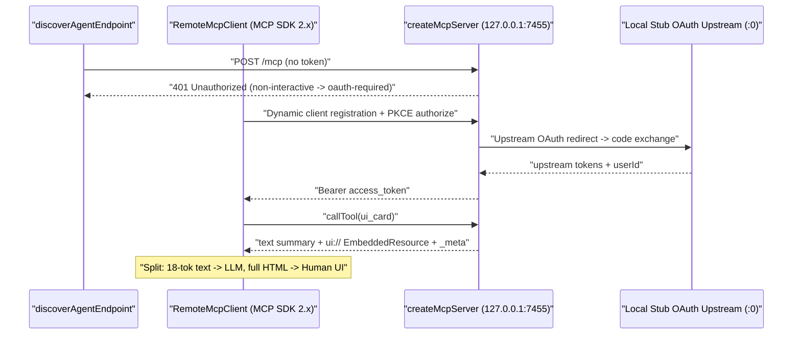

# Lab 05 — MCP OAuth 2.1 + `ui://` `EmbeddedResource` Round-Trip Lab

- **Goal:** Exercise an OAuth 2.1 `mcp-serve` Streamable HTTP server (`createMcpServer` / `MemoryStore`) paired with `RemoteMcpClient` (`@modelcontextprotocol/client` 2.x) and inspect the exact split between **concise text sent to the LLM** and **full `ui://` `EmbeddedResource` + `_meta` payloads preserved for the human**.
- **Modes:** Automated offline loopback OAuth 2.1 stub + interactive `RemoteMcpClient` inspector (plus `--live` against any real external MCP URL).
- **Repo Anchors:** [`packages/protocols/src/mcp-serve/server.ts`](../../packages/protocols/src/mcp-serve/server.ts), [`packages/protocols/src/mcp-serve/memory-store.ts`](../../packages/protocols/src/mcp-serve/memory-store.ts), [`packages/protocols/src/mcp/client/remote.ts`](../../packages/protocols/src/mcp/client/remote.ts), [`docs/specs/interfaces/protocols-and-extensions.md`](../../docs/specs/interfaces/protocols-and-extensions.md).

---

## 1. What You're Testing

- **`preserve-mcp-ui-embedded-resources`:** Does `RemoteMcpClient.callTool(...)` strip HTML noise from the model-facing text block while preserving `ui://` `EmbeddedResource` payloads and `_meta` in `_uiResources`?
- **OAuth 2.1 PKCE loop:** Does `401` + `WWW-Authenticate` discovery (`/oauth/register`, `/oauth/authorize`, `/oauth/upstream-callback`, `/oauth/token`) flow cleanly end-to-end against `MemoryStore`?
- **Non-interactive discovery safety:** Does `discoverAgentEndpoint` answer `"oauth-required"` cleanly on `401` without accidentally opening a browser auth flow?

---

## 2. Visual Target (Architecture & Mockup)



Target split-pane terminal/browser inspector:

```text
╔══════════════════════════════════════════════════════════════════════════════╗
║ MCP OAUTH + ui:// ROUND-TRIP LAB · server=http://127.0.0.1:7455              ║
╠══════════════════════════════════════════════════════════════════════════════╣
║ 1. Discovery Probe: kind=mcp  auth=oauth-required (browser NOT launched)     ║
║ 2. OAuth PKCE Grant: client=lab-cli  user=demo-user-1  token=sha256:4a1e..   ║
╠──────────────────────────────────────┬───────────────────────────────────────╣
║ WHAT THE MODEL SEES (text blocks)    │ WHAT THE HUMAN RENDERS (_uiResources) ║
│                                      │                                       │
│ tool: release_readiness_card         │ uri: ui://release/v0.6-card           │
│ text: "Release v0.6 readiness check: │ mimeType: text/html                   │
│   4 passing suites, 1 pending."      │ _meta: { "ui/panel": "summary" }      │
│                                      │                                       │
│ estimated tokens: ~16 tokens         │ rawHtml bytes: 2,418 bytes (0 tokens!)║
╚══════════════════════════════════════┴───────────────────────────────────────┘
```

---

## 3. Spin-Up & Prerequisites

Confirm `mcp-serve` mount tests and `discoverAgentEndpoint` pass before starting:

```zsh
pnpm exec vitest run packages/protocols/src/
```

---

## 4. Coding-Agent Prompt (Copy-Paste)

```text
Build a self-contained lab prototype under `examples/lab-05-mcp-oauth-ui/` testing the full OAuth 2.1 PKCE + Streamable HTTP MCP flow using `createMcpServer` (`@umwelten/protocols`), `RemoteMcpClient`, and `discoverAgentEndpoint`.

Read these files first to match exact types and invariants:
- `docs/specs/interfaces/protocols-and-extensions.md`
- `packages/protocols/src/mcp-serve/server.ts`
- `packages/protocols/src/mcp-serve/types.ts`
- `packages/protocols/src/mcp-serve/memory-store.ts`
- `packages/protocols/src/mcp/client/remote.ts`
- `packages/protocols/src/discovery/discover.ts`

Requirements:
1. Create `examples/lab-05-mcp-oauth-ui/run.ts` (plus `README.md`) with:
   - `--smoke`: fully automated loopback verification on ephemeral ports using a local mock upstream OAuth server (no external browser needed!).
   - `--serve --port 7455`: starts the `createMcpServer` instance on `127.0.0.1:7455` + mock upstream OAuth server so you can connect interactively or test PKCE login manually (`open`/browser).
   - `--probe <url> [--token <bearer>]`: runs `discoverAgentEndpoint` against any MCP or A2A URL.
2. Register two MCP tools in `McpToolRegistrar`:
   - `echo_identity`: proves `userId` and `getUpstreamToken()` resolved cleanly inside the tool handler without exposing raw upstream tokens to the model text.
   - `show_dashboard_card`: uses `buildHabitatUIResource` (or `createUIResource` from `@mcp-ui/server`) to return a concise 1-sentence text summary PLUS an `EmbeddedResource` (`uri: "ui://lab/dashboard"`, `mimeType: "text/html"`) and `_meta` fields.
3. In `--smoke` mode:
   - Call `discoverAgentEndpoint(mcpUrl)` without a token and assert `auth === "oauth-required"`.
   - Perform an automated loopback PKCE authorization-code exchange against `/oauth/register` -> `/oauth/authorize` -> local mock upstream redirect -> `/oauth/upstream-callback` -> `/oauth/token` (never touching `~/.umwelten/mcp-auth`; use a temp dir or in-memory bearer token).
   - Connect using `RemoteMcpClient` (`connect` -> `listTools` -> `callTool` on `show_dashboard_card`) and print the side-by-side **What the Model Sees** vs **What the Human Renders (`_uiResources` + `_meta`)** comparison table, asserting `_uiResources` contains `ui://lab/dashboard` and raw HTML was NOT stuffed into the plain model text!
4. Clean up servers and temp state in `finally` with zero `any` types and strict `tsc --noEmit` cleanliness.
```

---

## 5. Interactive Walkthrough (Kick the Tires)

1. **Observe `401` safety during probing:** Run `--probe http://127.0.0.1:7455/mcp` while `--serve` is running and verify discovery immediately reports `oauth-required` with zero interactive prompts.
2. **Test real `RemoteMcpClient` PKCE browser flow:** Connect to `--serve` using a temporary `~/.umwelten` or Safari login flow, authorize via the local upstream stub, and inspect the cached client/token JSON (`0600` permissions).
3. **Measure token savings:** Compare byte size of `_uiResources[0].text` vs. the concise model text returned by `show_dashboard_card`.

---

## 6. Did the Prompt Work? (Verification & Tuning)

```zsh
pnpm exec tsx examples/lab-05-mcp-oauth-ui/run.ts --smoke
pnpm exec tsc --noEmit --target ES2022 --module NodeNext --moduleResolution NodeNext --esModuleInterop --strict --skipLibCheck examples/lab-05-mcp-oauth-ui/run.ts
```

Pass criteria:
- `--smoke` exits `0`, asserting `auth === "oauth-required"`, successful PKCE token issuance, `echo_identity` success, and `_uiResources` + `_meta` preservation in `RemoteMcpClient`.
- Plain text response passed to the model does NOT duplicate raw HTML tags.

Tuning hints if the agent struggles:
- **`McpHttpServer` public URL mismatch on port `0`:** Inspect `packages/protocols/src/mcp-serve/public-url.ts` and pass `getPublicBaseUrl` or use `createMcpServeMount` with an explicit Node `http.createServer` listened on `0` so the OAuth metadata returns the actual bound loopback port (`http://127.0.0.1:<port>`).
- **PKCE redirects:** Have the automated `--smoke` harness follow HTTP `302` redirects manually (`redirect: "manual"`) so it deterministically extracts `code` and `state` without opening a browser.
