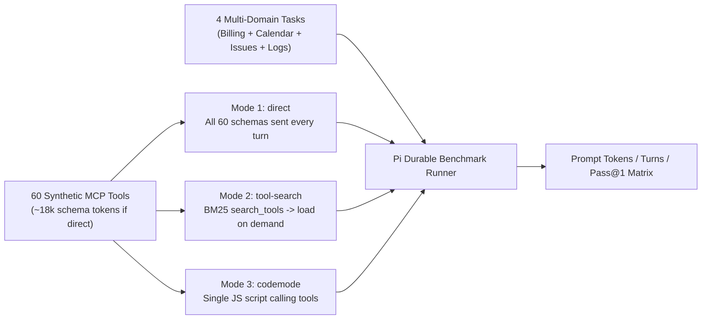

# Lab 06 — Many-Tool MCP Scaling: Direct vs. `tool-search` vs. `codemode`

- **Goal:** Benchmark what happens when an agent connects to many MCP servers (60+ tools across 4 domains) — comparing **direct tool schemas** vs. **BM25 lazy `tool-search`** vs. **`codemode`** across frontier and local models.
- **Modes:** Deterministic offline `fauxProvider` harness (default) and real model benchmark (`--live --models <spec1,spec2>`).
- **Repo Anchors:** [`packages/evaluation/src/coding/extensions.ts`](../../packages/evaluation/src/coding/extensions.ts), [`packages/protocols/src/mcp/client/remote.ts`](../../packages/protocols/src/mcp/client/remote.ts), [`examples/_shared/model-matrix.ts`](../_shared/model-matrix.ts).

---

## 1. What You're Testing

- **Context-window bloat:** At ~60–80 tools with realistic JSON Schemas, how many prompt tokens get burned *on every single turn* when every tool schema stays injected upfront?
- **Selection accuracy vs. indirection tax:** Does `tool-search` save tokens without causing local models (`qwen4`, `inkling-2-mini`) to miss the right tool or waste extra round-trip turns?
- **Chaining power (`codemode`):** On multi-step tasks ("fetch user -> list open issues -> cross-check SLA -> flag overdue"), does writing one JS snippet (`codemode`) beat 5 sequential tool-call turns on latency and cost?

---

## 2. Visual Target (Architecture & Mockup)



Target terminal benchmark scorecard:

```text
══════════════════════════════════════════════════════════════════════════════
 MANY-TOOL MCP SCALING LAB · 60 tools across 4 servers · 4 chaining tasks
══════════════════════════════════════════════════════════════════════════════
 Model                        Mode         Pass@1  Avg Turns  Prompt Tok   Latency
 ──────────────────────────────────────────────────────────────────────────────
 google:gemini-4-hydrogen     direct        4/4      4.8      74,200       8.1s
 google:gemini-4-hydrogen     tool-search   4/4      5.5      18,400 (-75%)6.4s
 google:gemini-4-hydrogen     codemode      4/4      2.0      11,900 (-84%)3.2s
 ollama:qwen4:32b             direct        2/4      6.0      62,100      41.0s
 ollama:qwen4:32b             tool-search   3/4      5.2      14,800 (-76%)19.4s
 ollama:qwen4:32b             codemode      4/4      2.5      12,100 (-81%)11.8s
══════════════════════════════════════════════════════════════════════════════
```

---

## 3. Spin-Up & Prerequisites

Review how `tool-search` and `codemode` are wired in our evaluation package before prompting:

```zsh
pnpm exec vitest run packages/evaluation/src/coding/coding-eval.test.ts
```

---

## 4. Coding-Agent Prompt (Copy-Paste)

```text
Build a self-contained MCP scaling lab under `examples/lab-06-mcp-scaling/` that mounts 60 synthetic tools across 4 simulated MCP domains over a real local `@modelcontextprotocol/sdk` MCP server (or `McpClient`) and compares `direct`, `tool-search`, and `codemode` extension strategies.

Read these repo files first to reuse existing extension mechanics rather than re-inventing them:
- `packages/evaluation/src/coding/extensions.ts` (inspect `tool-search`, `search-tools`, and `codemode` extension setup)
- `packages/habitat/src/durable/extensions.ts` (look at `createToolSearchExtension`)
- `packages/protocols/src/mcp/client/remote.ts`

Requirements:
1. Create `examples/lab-06-mcp-scaling/catalog.ts` defining 60 realistic tools (15 per domain: `billing`, `calendar`, `issues`, `audit-logs`, complete with JSON Schemas and in-memory deterministic fixtures so ~15–20k schema tokens exist when all 60 are exposed directly).
2. Expose those 60 tools over loopback MCP (`McpServer` + `StreamableHTTPServerTransport` on `127.0.0.1:0`) OR bridge them cleanly through `McpClient` (`@modelcontextprotocol/client` 2.x; was `@earendil-works/pi-mcp`) into Pi Durable `Harness` sessions so tool discovery & calls go through real MCP wire calls.
3. Define 4 multi-step ground-truth tasks (each requiring calling 2–4 specific tools across at least 2 domains and computing a deterministic exact answer checked by a verifier function).
4. Create `examples/lab-06-mcp-scaling/run.ts`:
   - Default offline mode: scripted `fauxProvider` responses demonstrating all 3 modes (`direct`, `tool-search`, `codemode`) across 4 tasks, printing a clean scorecard table (Pass@1, Avg Turns, Prompt Tokens, Completion Tokens, Schema-Token Reduction %).
   - `--live --models <spec1,spec2> [--modes direct,tool-search,codemode]`: executes real models via `resolvePiModel(parseModelSpecString(...))` (cloud concurrency <= 2, local ollama/mlx concurrency 1).
   - Writes an optional JSON report under `output/lab-06-mcp-scaling/`.
5. Keep strict TypeScript (`zero any`), clean teardown of `Harness` + HTTP MCP transport in `finally`, and confirm offline mock run passes in < 5s.
```

---

## 5. Interactive Walkthrough (Kick the Tires)

1. **Measure baseline schema tax offline:** Run the offline scorecard and verify how `direct` compares to `tool-search` and `codemode`.
2. **Test a small local model (`--live`):** Run with `--live --models ollama:qwen4:32b --modes direct,tool-search` (or `ollama:inkling-2-mini:latest`) and watch where the model picks a lookalike distractor tool out of 60 options vs. searching first.
3. **Test `codemode` chaining:** Run `--live --models google:gemini-4-hydrogen --modes tool-search,codemode` and inspect how many turns it takes to join data across `issues` + `audit-logs`.

---

## 6. Did the Prompt Work? (Verification & Tuning)

```zsh
pnpm exec tsx examples/lab-06-mcp-scaling/run.ts
pnpm exec tsc --noEmit --target ES2022 --module NodeNext --moduleResolution NodeNext --esModuleInterop --strict --skipLibCheck examples/lab-06-mcp-scaling/catalog.ts examples/lab-06-mcp-scaling/run.ts
```

Pass criteria:
- Offline run exercises real Pi Durable `Harness` + `McpClient` calls, scores `4/4` on all configured mock paths, prints prompt-token differences cleanly, and exits `0`.

Tuning hints if the agent struggles:
- **`codemode` sandbox missing registered MCP tools:** Inspect how `packages/evaluation/src/coding/extensions.ts` passes tool definitions to `codemode` so bridged MCP `ExecutableTool`s are visible inside the JS execution environment.
- **Port conflict or hanging MCP client:** Call `await mcpClient.close()` and close the HTTP server in `finally` with `server.closeIdleConnections?.()`.
