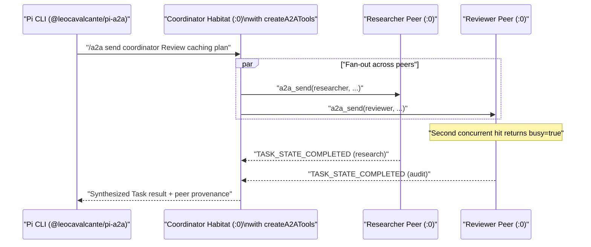

# Lab 07 — Multi-A2A Peer Mesh & Pi Coordinator

- **Goal:** Upgrade the multi-agent A2A setup from [`examples/multi-a2a/e2e.ts`](../multi-a2a/e2e.ts) into a **peer-to-peer A2A mesh** (Pi → Coordinator `DurableHabitat` → specialist peers) with `createA2ATools` from `@leocavalcante/pi-a2a/durable`, live concurrent task visualization, and busy-peer / cycle-guard drills.
- **Modes:** Offline mock (`fauxProvider`, default), interactive Pi session (`--interactive`), and real multi-model runs (`--live --model <provider:model>`).
- **Repo Anchors:** [`examples/multi-a2a/e2e.ts`](../multi-a2a/e2e.ts), [`packages/habitat/src/durable/gaia-host.ts`](../../packages/habitat/src/durable/gaia-host.ts), [`packages/protocols/src/index.ts`](../../packages/protocols/src/index.ts), [`packages/habitat/src/durable/durable-habitat.ts`](../../packages/habitat/src/durable/durable-habitat.ts).

---

## 1. What You're Testing

- **Coordinator vs. flat Pi delegation:** Is it cleaner when Pi talks directly to 3 leaf agents (flat `agents.json`), or when Pi delegates once to a Coordinator Habitat equipped with `createA2ATools`?
- **Busy-peer behavior:** When two tasks hit the same peer conversation simultaneously, how does `UNSUPPORTED_OPERATION` (`busy: true`) behave and should the coordinator retry, fork, or spawn another peer?
- **Loop / self-delegation prevention:** Does a peer mesh prevent `coordinator -> researcher -> coordinator` infinite loops and keep credentials isolated per directional peer token?

---

## 2. Visual Target (Architecture & Mockup)



Target terminal live watch widget / trace output:

```text
╔══════════════════════════════════════════════════════════════════════════════╗
║ MULTI-A2A PEER MESH · Pi -> coordinator -> [researcher, reviewer]            ║
╠══════════════════════════════════════════════════════════════════════════════╣
│ Task Timeline (SSE / Terminal Watch):                                        │
│   [coord]      task=4c1a..  WORKING    fanning out to 2 peer(s)              │
│     ├─ [researcher] task=9f20.. COMPLETED  (340ms) tok_in=112 out=48         │
│     ├─ [reviewer]   task=a811.. BUSY (420) -> backed off 200ms -> COMPLETED  │
│     └─ [self-loop]  coordinator -> coordinator -> BLOCKED (SELF_DELEGATION)  │
│   [coord]      task=4c1a..  COMPLETED  synthesized 2 peer reports (910ms)    │
╚══════════════════════════════════════════════════════════════════════════════╝
```

---

## 3. Spin-Up & Prerequisites

Verify the baseline flat multi-A2A test passes first:

```zsh
pnpm run demo:multi-a2a
```

---

## 4. Coding-Agent Prompt (Copy-Paste)

```text
Build a peer-to-peer A2A mesh lab under `examples/lab-07-a2a-mesh/` extending the pattern in `examples/multi-a2a/e2e.ts` so a Coordinator `DurableHabitat` discovers and delegates to specialist A2A peers using `createA2ATools` from `@leocavalcante/pi-a2a/durable` (re-exported by `@umwelten/protocols`), while Pi talks to the Coordinator (or directly to peers).

Read these files first:
- `examples/multi-a2a/e2e.ts`
- `packages/protocols/src/index.ts`
- `packages/protocols/node_modules/@leocavalcante/pi-a2a/README.md` (section "Private discovery and delegation")
- `packages/protocols/node_modules/@leocavalcante/pi-a2a/src/durable-tools.ts`
- `packages/habitat/src/durable/durable-habitat.ts`

Requirements:
1. Create `examples/lab-07-a2a-mesh/run.ts` (plus `README.md`) supporting default offline `fauxProvider` mode, `--interactive`, and `--live --model <provider:model>`.
2. Start 3 isolated `DurableHabitat` A2A 1.0 HTTP servers on separate loopback ports (`127.0.0.1:0`):
   - `researcher` & `reviewer`: specialist agents with distinct per-agent bearer tokens.
   - `coordinator`: configured with `createA2ATools({ self: "coordinator", ... })` (reading a peer `agents.json` in `tmpRoot` pointing to `researcher` and `reviewer` with `bearerTokenEnv`) so the coordinator itself can list `a2a_agents` and delegate via `a2a_send`.
3. Exercise and print a crisp timeline for all 3 edge cases in default automated mode (plus interactive Pi test if `--interactive` is passed):
   - Happy-path multi-hop delegation: `pi` CLI (using `PI_A2A_CONFIG` pointing to `coordinator`) sends one prompt -> `coordinator` invokes `a2a_send` to `researcher` and `reviewer` -> synthesizes final response back to `pi`.
   - Busy-peer rejection drill: force `reviewer` into an in-flight delayed turn, send a second peer message while busy, confirm `busy` rejection is surfaced cleanly without hanging, then retry cleanly after the first completes.
   - Loop protection check: verify self-delegation (`coordinator -> coordinator`) fails safely (`SELF_DELEGATION`).
4. Ensure all child `pi` calls are async (`spawn`, never `spawnSync`, so loopback servers never deadlock!), tear down servers/habitats/`tmpRoot` cleanly in `finally`, and pass strict `tsc --noEmit`.
```

---

## 5. Interactive Walkthrough (Kick the Tires)

1. **Test 2-hop coordination live:** Run `pnpm exec tsx examples/lab-07-a2a-mesh/run.ts --interactive --live --model google:gemini-4-hydrogen` and ask Pi to delegate an architecture + security review through `coordinator`.
2. **Inspect `contextId` isolation:** Ask `coordinator` two unrelated questions in separate Pi invocations and check `researcher`/`reviewer` SQLite histories (`@umwelten/sessions`) to verify peer contexts didn't bleed across callers.
3. **Compare ergonomics vs. flat Pi:** Contrast directing peers yourself via Pi's `/a2a send` vs. letting `coordinator` orchestrate behind a single A2A task.

---

## 6. Did the Prompt Work? (Verification & Tuning)

```zsh
pnpm exec tsx examples/lab-07-a2a-mesh/run.ts
pnpm exec tsc --noEmit --target ES2022 --module NodeNext --moduleResolution NodeNext --esModuleInterop --strict --skipLibCheck examples/lab-07-a2a-mesh/run.ts
```

Pass criteria:
- Automated run prints verified multi-hop `pi -> coordinator -> [researcher, reviewer]` completion, deterministic busy-peer detection + recovery, and self-delegation guard pass with exit `0`.

Tuning hints if the agent struggles:
- **Pi CLI deadlocks hitting parent-process A2A servers:** Confirm the runner uses async `child_process.spawn` instead of `spawnSync` (the exact deadlock pattern solved in `examples/multi-a2a/e2e.ts`).
- **Missing peer config path in `createA2ATools`:** Inspect `packages/protocols/node_modules/@leocavalcante/pi-a2a/src/durable-tools.ts` and `config.ts` (`PI_A2A_CONFIG` env var).
