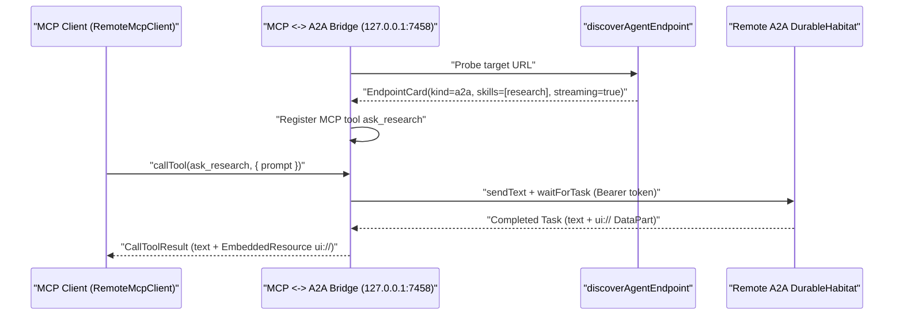

# Lab 08 — Universal URL Probe & MCP ↔ A2A Protocol Bridge

- **Goal:** Build a single inspector & adapter where pasting *any* URL detects whether it speaks A2A or MCP (plus its capabilities and auth scheme via `discoverAgentEndpoint`), and exposes a thin bridge translating a remote A2A `DurableHabitat` (including `ui://` `DataPart`s) into standard MCP tools.
- **Modes:** Offline mock end-to-end suite (default), loopback web inspector (`--serve --port 7458`), and `--probe <url>` CLI mode for external URLs.
- **Repo Anchors:** [`packages/protocols/src/discovery/discover.ts`](../../packages/protocols/src/discovery/discover.ts), [`packages/protocols/src/mcp-serve/server.ts`](../../packages/protocols/src/mcp-serve/server.ts), [`packages/habitat/src/ui-resources.ts`](../../packages/habitat/src/ui-resources.ts), [`packages/protocols/node_modules/@leocavalcante/pi-a2a/src/client.ts`](../../packages/protocols/node_modules/@leocavalcante/pi-a2a/src/client.ts).

---

## 1. What You're Testing

- **Zero-guesswork discovery:** Given arbitrary path-mounted URLs (`/habitats/research`, `/agents/demo/mcp`, `/.well-known/agent-card.json`), does `discoverAgentEndpoint` reliably classify `kind: "a2a" | "mcp"` and `auth: "open" | "bearer" | "oauth-required"`?
- **Protocol translation (`A2A -> MCP`):** How cleanly can a remote A2A agent (long-running task + text + `DataPart` `text/html+mcp`) be wrapped as an MCP tool so any off-the-shelf MCP host (`pi`, Claude Desktop, Cursor) can call it and still receive `ui://` `EmbeddedResource`s?

---

## 2. Visual Target (Architecture & Mockup)



Target URL Probe & Bridge console / UI card:

```text
╔══════════════════════════════════════════════════════════════════════════════╗
║ UNIVERSAL ENDPOINT PROBE & MCP-A2A BRIDGE · http://127.0.0.1:7458            ║
╠══════════════════════════════════════════════════════════════════════════════╣
│ Paste URL: [ http://127.0.0.1:52910                    ] [Probe] [Bridge]   │
│                                                                              │
│ ┌─ PROBE RESULT ──────────────────────────────────────────────────────────┐  │
│ │ Kind: a2a   Auth: bearer   Streaming: true   Version: 0.6.0             │  │
│ │ Endpoint URL: http://127.0.0.1:52910/a2a                                │  │
│ │ Capabilities (1 skill):                                                 │  │
│ │   • release-auditor — Audits diff & emits ui:// readiness card          │  │
│ └─────────────────────────────────────────────────────────────────────────┘  │
│ ┌─ BRIDGED AS MCP SERVER ─────────────────────────────────────────────────┐  │
│ │ MCP URL: http://127.0.0.1:7458/mcp                                      │  │
│ │ Exposed Tool: ask_release_auditor(message: string)                      │  │
│ │ Last Bridged Call: text=22 chars | _uiResources=1 (ui://audit/card)     │  │
│ └─────────────────────────────────────────────────────────────────────────┘  │
╚══════════════════════════════════════════════════════════════════════════════╝
```

---

## 3. Spin-Up & Prerequisites

Verify endpoint discovery tests pass first:

```zsh
pnpm exec vitest run packages/protocols/src/discovery/discover.test.ts
```

---

## 4. Coding-Agent Prompt (Copy-Paste)

```text
Build a self-contained lab prototype under `examples/lab-08-url-bridge/` that combines a universal URL protocol inspector (`discoverAgentEndpoint`) with a thin MCP-to-A2A bridge translating an A2A `DurableHabitat` (including `ui://` `DataPart` payloads) onto a local Streamable HTTP MCP server.

Read these repo files first:
- `packages/protocols/src/discovery/discover.ts`
- `packages/protocols/node_modules/@leocavalcante/pi-a2a/src/client.ts`
- `packages/habitat/src/ui-resources.ts` (`UI_OUTPUT_MODE`, `HabitatUIResource`)
- `packages/protocols/src/mcp/client/remote.ts`

Requirements:
1. Create `examples/lab-08-url-bridge/run.ts` (plus `README.md`) supporting:
   - `--probe <url> [--token <bearer>]`: runs `discoverAgentEndpoint` and renders normalized `kind`, resolved endpoint `url`, `auth`, `streaming`, and capabilities.
   - `--serve --port 7458`: runs a loopback Warm Paper web UI where you can paste any URL to probe it live AND click to mount an A2A endpoint onto the local bridge (`127.0.0.1:7458`).
   - `--smoke` (and default): runs an end-to-end automated round-trip on ephemeral loopback ports (`127.0.0.1:0`).
2. Bridge mechanics (`A2A -> MCP`):
   - Connect to the target A2A endpoint using `@leocavalcante/pi-a2a/client` (`connectAgent`, `sendText`, `isTask`, `waitForTask`).
   - Expose one MCP tool per A2A skill (or `ask_<agent>`) via `@modelcontextprotocol/sdk`'s `McpServer` + `StreamableHTTPServerTransport` (do NOT roll a custom JSON-RPC MCP client!).
   - When an A2A completed task contains both text parts and a `DataPart` tagged with `outputMode: "text/html+mcp"` (or a `HabitatUIResource`-shaped object), translate it back into a standard MCP `CallToolResult` containing the text block AND a `{ type: "resource", resource: uiResource }` block.
3. In automated `--smoke` mode:
   - Start a mock `DurableHabitat` A2A server whose tool publishes a `ui://bridge/report` resource via `buildHabitatUIResource` / `publishUIResource`.
   - Start an open mock MCP server as a second probe target.
   - Probe both with `discoverAgentEndpoint` (asserting `kind === "a2a"` on one and `kind === "mcp"` on the other).
   - Start the A2A->MCP bridge targeting the `DurableHabitat`, connect `RemoteMcpClient` (`@umwelten/protocols`) to the bridge, call the bridged tool, and verify BOTH the concise text answer AND `_uiResources` preserving `ui://bridge/report` arrive intact at the MCP client!
4. Clean shutdown in `finally`, zero `any` types, strict `tsc --noEmit` passing.
```

---

## 5. Interactive Walkthrough (Kick the Tires)

1. **Test live URL detection (`--probe`):** Run `--probe` against a `GaiaHost` root (`http://127.0.0.1:7430`), a child Habitat (`http://127.0.0.1:7430/habitats/research`), and Lab 05's MCP server (`http://127.0.0.1:7455/mcp`) and verify every `kind` and `auth` badge.
2. **Test live UI bridge (`--serve`):** Paste a running A2A Habitat URL into `http://127.0.0.1:7458`, mount it as an MCP tool, and inspect the converted `CallToolResult` (`text` vs. `_uiResources`) right in the browser.
3. **Wire the bridge into `pi` (`pi mcp`):** Point a standard Pi session at `http://127.0.0.1:7458/mcp` so `pi` can call a remote A2A Habitat through ordinary MCP tooling without `pi-a2a`.

---

## 6. Did the Prompt Work? (Verification & Tuning)

```zsh
pnpm exec tsx examples/lab-08-url-bridge/run.ts --smoke
pnpm exec tsc --noEmit --target ES2022 --module NodeNext --moduleResolution NodeNext --esModuleInterop --strict --skipLibCheck examples/lab-08-url-bridge/run.ts
```

Pass criteria:
- `--smoke` confirms `discoverAgentEndpoint` distinguishes `a2a` vs. `mcp`, the bridge starts cleanly, and `RemoteMcpClient` receives both text and `_uiResources` containing `ui://bridge/report`.

Tuning hints if the agent struggles:
- **`DataPart` shape mismatch from A2A task artifacts:** Check `packages/habitat/src/ui-resources.ts` (`uiResourceToA2APart` and `UI_OUTPUT_MODE = "text/html+mcp"`) to see the exact `part.data` and `part.metadata` properties emitted on completed A2A tasks.
- **`RemoteMcpClient` URL or auth errors on open loopback MCP:** Inspect `packages/protocols/src/mcp/client/remote.ts` to confirm open MCP endpoints connect without triggering OAuth redirect errors.
