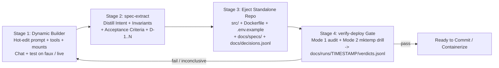

# Lab 09 — Dynamic Agent Builder → `session-spec-verify` → Production Ejection

- **Goal:** Tie the whole prototyping workflow together into one end-to-end factory: interactively **assemble and test** a custom agent in a live sandbox (instructions, Owned/Mounted repos, cron schedules, MCP/A2A tools, `ui://` outputs), **distill specs & decisions** with `spec-extract`, **eject** a clean standalone production repository (zero monorepo scratch baggage), and gate it with **`verify-deploy`** (`docs/runs/` immutable verdicts).
- **Modes:** Offline mock (`fauxProvider`, default) + live models (`--live --model <provider:model>`) + interactive Builder Web UI (`--port 7459`).
- **Repo Anchors:** [`packages/habitat/src/durable/durable-habitat.ts`](../../packages/habitat/src/durable/durable-habitat.ts), [`packages/habitat/src/durable/gaia-host.ts`](../../packages/habitat/src/durable/gaia-host.ts), [`packages/habitat/Dockerfile`](../../packages/habitat/Dockerfile), [`docs/INDEX.md`](../../docs/INDEX.md), [`.agents/skills/spec-extract/SKILL.md`](../../.agents/skills/spec-extract/SKILL.md), [`.agents/skills/verify-deploy/SKILL.md`](../../.agents/skills/verify-deploy/SKILL.md), [`.agents/skills/spec-refactor/scripts/check-specs.ts`](../../.agents/skills/spec-refactor/scripts/check-specs.ts).

---

## 1. What You're Testing

- **Live iteration speed:** How fast can you tweak an agent's system prompt, toggle tools/scopes/crons, chat with it, and see its SQLite trace + `ui://` outputs before writing a single boilerplate repo?
- **Spec-driven graduation (`session-spec-verify`):** Once the agent behaves the way you like in the sandbox, can we distill its **Intent**, **Invariants**, **Acceptance Criteria** (`[kebab-slug]`), and **Decisions** (`docs/decisions.jsonl`) directly from the prototype session into the target repo *before* shipping?
- **Clean production ejection:** Does the ejected directory stand completely on its own (`package.json`, `tsconfig.json`, `src/agent.ts`, `src/server.ts`, `Dockerfile`, `.env.example`, `docs/INDEX.md`, `docs/specs/...`, `docs/decisions.jsonl`) and pass both `check-specs.ts` AND an isolated `verify-deploy` Mode 2 sandbox audit?

---

## 2. Visual Target (Architecture & Mockup)



Target Warm Paper Builder + Spec-Verify Workbench UI (`http://127.0.0.1:7459`):

```text
┌──────────────────────────────────────────────────────────────────────────────┐
│ AGENT STUDIO · Dynamic Sandbox -> Spec Extract -> Prod Eject  [v: prototype] │
├───────────────────────────────────┬──────────────────────────────────────────┤
│ AGENT CONFIG (Hot-Reload)         │ LIVE SANDBOX CHAT & VERIFY LOG           │
│ Id:       release-steward         │ > You: Check release readiness in repo   │
│ Model:    google:gemini-4-hydrogen│ [Tool] read PACKAGE -> 4 suites green    │
│ Repo R/W: ./sandbox-repo          │ [UI]   ui://steward/checklist rendered   │
│ Repo R/O: ./policies (Mounted)    │ > Steward: All checks pass except README.│
│ Cron:     "0 9 * * *" (off)       │                                          │
│ Auth:     A2A Bearer (enabled)    │ ── STAGE 2: EXTRACTED SPEC PREVIEW ────  │
│ Tools:    [x] repo-scope          │ • [mounted-policies-read-only] (inv)     │
│           [x] ui-resources        │ • [bearer-required-on-a2a]     (inv)     │
│           [ ] a2a-peers           │ • [ejected-health-check]       (ac)      │
│                                   │                                          │
│ [Apply & Reload Habitat]          │ ── STAGE 4: VERIFY-DEPLOY VERDICTS ────  │
│ [1 Extract Spec] [2 Eject Repo]   │ [PASS] specs/agent-contract check-specs  │
│ [3 Run verify-deploy Gate]        │ [PASS] Mode 2: 401 unauth A2A verified   │
│                                   │ [PASS] Mode 2: R/O mount write blocked   │
└───────────────────────────────────┴──────────────────────────────────────────┘
```

Example clean ejected production directory emitted by Stage 3:

```text
<eject-target-dir>/
├── package.json              # standalone scripts: dev, start, test, verify:specs
├── tsconfig.json
├── Dockerfile                # Node 24-slim single-process DurableHabitat service
├── .env.example              # A2A_BEARER_TOKEN=, PORT=7460, HABITAT_DATA_DIR=./data
├── src/
│   ├── agent.ts              # DurableHabitat wiring: instructions, repo-scope, tools, ui://
│   ├── server.ts             # A2A 1.0 + /health + bearer auth + graceful SIGINT/SIGTERM
│   └── agent.test.ts         # offline fauxProvider contract tests matching acceptance criteria
└── docs/
    ├── INDEX.md
    ├── decisions.jsonl       # distilled why decisions from sandbox exploration
    ├── standards/            # copied adopted standards (per-speaker-agent-identity, etc.)
    ├── specs/
    │   └── agent/
    │       └── contract.md   # Intent, Invariants, Acceptance Criteria, Verification
    └── runs/
        └── 2026-11-24T12-00-00Z_uncommitted-dirty/
            ├── verdicts.jsonl
            └── summary.md
```

---

## 3. Spin-Up & Prerequisites

Verify `check-specs.ts` and existing workspace specs run cleanly before building Lab 09:

```zsh
pnpm run specs:check
pnpm run specs:effective
```

---

## 4. Coding-Agent Prompt (Copy-Paste)

```text
Build a self-contained "Dynamic Agent Builder -> Session Spec Verify -> Production Ejection" lab under `examples/lab-09-agent-factory/` on top of `@umwelten/habitat` and our `.agents/skills/{spec-extract,spec-refactor,verify-deploy}` spec validator (`check-specs.ts`).

Read these files first to match exact APIs and spec formats:
- `packages/habitat/src/durable/durable-habitat.ts`
- `packages/habitat/src/durable/extensions.ts`
- `packages/habitat/Dockerfile`
- `docs/INDEX.md`
- `docs/specs/orchestration/durable-habitats.md`
- `.agents/skills/spec-extract/SKILL.md`
- `.agents/skills/verify-deploy/SKILL.md`
- `.agents/skills/spec-refactor/scripts/check-specs.ts`

Requirements:
1. Create:
   - `examples/lab-09-agent-factory/eject.ts` (clean declarative agent config schema + generator that extracts a standalone runnable agent project + `docs/specs/` + `docs/decisions.jsonl` into an explicit target directory, with zero scratch/mock monorepo clutter).
   - `examples/lab-09-agent-factory/verify.ts` (programmatic runner executing `check-specs.ts --root <ejectDir> --effective --json`, running static + Mode 2 `mktemp -d` isolated runtime drills against the ejected agent — HTTP `/health`, `401` unauth A2A, authorized A2A task, and R/O mount enforcement — and writing an immutable `docs/runs/<timestamp>_<sha>/{verdicts.jsonl,summary.md}` pass validated again with `check-specs.ts --root <ejectDir>`!).
   - `examples/lab-09-agent-factory/server.ts` (Bell Labs Warm Paper HTTP + SSE Builder UI on `127.0.0.1:7459` where you hot-edit an agent config — name, model, instructions, Owned/Mounted paths, optional cron schedule, A2A auth, `ui://` tools — test it in live chat over offline `fauxProvider` or `--live`, preview distilled specs/decisions, click **Eject Production Repo** into a chosen output dir, and click **Run verify-deploy Gate** to see immutable PASS/FAIL verdicts!).
   - `README.md`.
2. Ensure `--smoke` mode in `server.ts` (or `run.ts`):
   - Boots the Dynamic Builder on port `0`, hot-reloads an agent config with an Owned R/W dir + Mounted R/O policy dir, runs a chat turn + tool trace, ejects the agent into a temporary `mktemp -d` standalone directory, runs `check-specs.ts --root <ejectDir>` AND `verify.ts` against that ejected directory, asserts every rule verdict in `verdicts.jsonl` is `"pass"`, and cleans up temp state cleanly in `finally`.
3. IMPORTANT for `eject.ts`: keep generated specs genuinely aligned with `.agents/skills/spec-refactor/scripts/check-specs.ts` schema requirements (YAML frontmatter `kind: spec`, `id`, `title`, `layer`, `version: 1`, `## Intent`, `## Invariants`, `## Acceptance Criteria` with `**[kebab-slug]**`, `## Verification`, valid `docs/INDEX.md` links, and valid JSON lines in `docs/decisions.jsonl` and `docs/runs/.../verdicts.jsonl`). Verify by running `node --experimental-strip-types .agents/skills/spec-refactor/scripts/check-specs.ts --root <ejectDir>` directly inside `--smoke`!
4. Bind UI/HTTP strictly to `127.0.0.1`, validate inline `<script>` with `new Function`, use zero `any` types, and keep `pnpm run specs:check` on the main repo completely green.
```

---

## 5. Interactive Walkthrough (Kick the Tires)

Once the Builder UI is running (`pnpm exec tsx examples/lab-09-agent-factory/server.ts`), walk through the full prototype-to-production loop:

1. **Iterate dynamically in the sandbox:** Edit the instructions, toggle `Mounted R/O` policies, send 2–3 test prompts in the chat pane, and confirm the agent calls tools and respects boundaries.
2. **Switch to real LLM sanity check (`--live`):** Restart with `--live --model google:gemini-4-hydrogen` (or your local Ollama model) and verify the prompt instructions steer the real model cleanly.
3. **Eject into a clean temp or sibling folder:** Point Eject Target to `/tmp/ejected-release-steward` and inspect the generated files — check that `src/server.ts`, `Dockerfile`, `.env.example`, and `docs/specs/` contain only what that single agent needs.
4. **Gate with `verify-deploy`:** Click **Run verify-deploy Gate** (or run the `verify-deploy` skill directly inside `/tmp/ejected-release-steward`) and open the immutable `docs/runs/<timestamp>/summary.md` to confirm every invariant (`401` unauth A2A, R/O mount write block, health endpoint) holds with real evidence.
5. **Break something on purpose:** Temporarily set `allowUnauthenticatedLoopback: true` or drop the auth middleware in the ejected `src/server.ts`, re-run `verify.ts`, and verify a new immutable run directory is created recording `[FAIL]` instead of overwriting the prior passing run!

---

## 6. Did the Prompt Work? (Verification & Tuning)

```zsh
pnpm exec tsx examples/lab-09-agent-factory/server.ts --smoke
pnpm exec tsc --noEmit --target ES2022 --module NodeNext --moduleResolution NodeNext --esModuleInterop --strict --skipLibCheck examples/lab-09-agent-factory/eject.ts examples/lab-09-agent-factory/verify.ts examples/lab-09-agent-factory/server.ts
pnpm run specs:check
```

Pass criteria:
- `--smoke` exits `0`, runs `check-specs.ts --root <ejectedDir>` cleanly with zero schema errors, and writes a passing `docs/runs/<timestamp>/verdicts.jsonl` + `summary.md`.
- `pnpm run specs:check` on `umwelten` itself still passes cleanly.

Tuning hints if the agent struggles:
- **`check-specs.ts` rejects generated `decisions.jsonl` or `verdicts.jsonl`:** Have the coding agent read lines 1–200 of `.agents/skills/spec-refactor/scripts/check-specs.ts` plus `docs/decisions.jsonl` and `docs/runs/` in this repo before editing `eject.ts` / `verify.ts` so every required JSON field (`id`, `type`, `outcome`, `author`, `packs`, `summary`, etc.) matches exact schema.
- **Standalone ejected repo won't boot outside the monorepo:** Make sure `eject.ts` references installable package names (`@earendil-works/pi-durable`, `@leocavalcante/pi-a2a`) cleanly OR documents copying workspace packages in `Dockerfile` (matching `packages/habitat/Dockerfile`).
